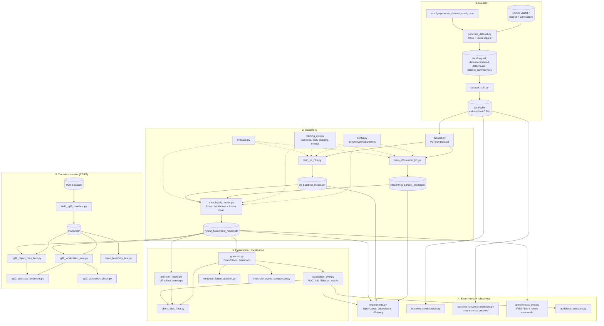

# Localization-Aware Explainable Detection of Diffusion-Based Image Manipulations

MTech thesis code: detect **and localize** SDXL-inpainting manipulations in photographs using a
hybrid **CNN (EfficientNet-B3) + ViT (ViT-B/16)** fusion classifier, explained with **Grad-CAM++**
and evaluated against ground-truth manipulation masks.

## What the project does

1. **Builds a benchmark** of 1,200 real/manipulated image pairs: object instances from COCO
   val2017 are masked and either removed or replaced (e.g. dog -> wolf) with Stable Diffusion XL
   inpainting. Every manipulated image has a pixel-accurate ground-truth mask.
2. **Trains three classifiers** (real vs. manipulated): EfficientNet-B3, ViT-B/16, and a hybrid
   that concatenates the two frozen backbones' features and trains a fusion head.
3. **Explains the hybrid's decisions** with Grad-CAM++ (CNN branch, ViT branch, combined) and
   Attention Rollout (ViT), then **scores the heatmaps against the true masks** (AUC, IoU, Dice).
4. **Runs the statistical evaluation**: paired significance tests, breakdowns, external baselines
   (CNNDetection, UniversalFakeDetect), an object-bias floor, zero-shot transfer to the TGIF2
   dataset, and robustness to anti-forensic attacks (JPEG, blur, noise, downscaling).

## Why it is useful

Most fake-image detectors return a single real/fake score. For forensic use you also need to know
**where** the image was edited and **why** the model thinks so. This project measures whether a
detector's explanation actually points at the edited region, instead of assuming it does.

Headline results on the 352-image held-out test set (from `outputs/*/test_metrics.json` and
`outputs/localization_eval/localization_metrics.json`):

| Model           | Accuracy | F1    | ROC-AUC |
|-----------------|----------|-------|---------|
| EfficientNet-B3 | 0.932    | 0.929 | 0.978   |
| ViT-B/16        | 0.830    | 0.840 | 0.944   |
| Hybrid fusion   | **0.943**| **0.941** | **0.982** |

| Heatmap (176 manipulated test images) | Pixel AUC | IoU   | Dice  |
|---------------------------------------|-----------|-------|-------|
| CNN-branch Grad-CAM++                 | **0.914** | **0.265** | **0.401** |
| ViT-branch Grad-CAM++                 | 0.643     | 0.072 | 0.122 |
| Hybrid (50/50) Grad-CAM++             | 0.883     | 0.100 | 0.163 |

Recommendation from these results: use the hybrid model for classification and the CNN-branch
Grad-CAM++ for localization.

## Architecture block diagram



**Hybrid model** (`train_hybrid_fusion.py`):

```
image (224x224) --+--> EfficientNet-B3 (frozen) --> 1536-d --> Linear 256 --+
                  |                                                         +--> concat (512) --> MLP (256) --> 1 logit
                  +--> ViT-B/16 (frozen) ---------> 768-d CLS --> Linear 256 -+                     (real / manipulated)
```

## Repository layout

| Path | Purpose |
|------|---------|
| `generate_dataset.py`, `dataset_split.py` | Phase 1-2: build the SDXL benchmark and split it 842/182/176 pairs |
| `config.py`, `dataset.py`, `training_utils.py`, `evaluate.py` | Shared config, data loading, training loop, metrics |
| `train_efficientnet_b3.py`, `train_vit_b16.py`, `train_hybrid_fusion.py` | Phase 3-5: the three classifiers |
| `gradcam.py`, `attention_rollout.py` | Phase 6: heatmap generation |
| `localization_eval.py`, `weighted_fusion_ablation.py`, `threshold_sweep_comparison.py`, `object_bias_floor.py` | Phase 7: score heatmaps against masks |
| `experiments.py`, `additional_analyses.py`, `antiforensics_eval.py` | Phase 8: statistics, breakdowns, robustness |
| `baseline_cnndetection.py`, `baseline_universalfakedetect.py`, `external_models/` | Published external baselines (UniversalFakeDetect CLIP code is vendored, MIT license) |
| `build_tgif2_manifest.py`, `tgif2_*.py`, `trace_feasibility_test.py` | Zero-shot evaluation on the TGIF2 dataset |
| `configs/` | JSON configs for dataset generation and splitting |
| `data/splits/`, `data/dataset_summary.csv` | The exact train/val/test split used for every reported number |
| `manifests/` | TGIF2 image manifest and split |
| `notebooks/` | Kaggle / Colab runners for SDXL generation (needs a GPU) |

## Getting started

### Requirements

- Python 3.11+ (developed on 3.13)
- CPU is enough for training/evaluation. **Dataset generation (SDXL) needs a GPU**: use the
  notebooks in `notebooks/` on Kaggle or Colab.
- Python packages: see `requirements.txt`

```bash
git clone <this-repo-url>
cd localization-aware-detection
python -m venv .venv && source .venv/bin/activate
pip install -r requirements.txt
```

### What is *not* in this repository

Images, model checkpoints and third-party weights are too large for git (checkpoints are
45-390 MB each). All scripts expect them at these default paths, relative to the repo root:

| Needed for | Path | How to get it |
|------------|------|---------------|
| Dataset generation | `data/coco/val2017/`, `data/coco/annotations/instances_val2017.json` | Download COCO 2017 val images + annotations from https://cocodataset.org |
| Training / evaluation | `data/original/`, `data/manipulated/`, `data/masks/` | Run `generate_dataset.py` (GPU) |
| Heatmaps / evaluation | `outputs/{efficientnet_b3,vit_b16,hybrid_fusion}/best_model.pth` | Run the three training scripts |
| CNNDetection baseline | `external_weights/cnndetection_blur_jpg_prob0.5.pth` | https://github.com/PeterWang512/CNNDetection |
| UniversalFakeDetect baseline | `external_weights/universalfakedetect_fc_weights.pth` | `pretrained_weights/fc_weights.pth` from https://github.com/WisconsinAIVision/UniversalFakeDetect |
| TGIF2 evaluation | `tgif-dataset/` | TGIF2 dataset release |

### Quick start (default settings)

Every script runs from the repo root with sensible defaults. Most accept `--dry-run`, which
loads the data/models and runs the pipeline on a couple of batches (it needs the data and
checkpoints listed above). A dry run still writes a summary and log into its output folder, so
pass a scratch `--output-dir` to avoid overwriting real results.

Check the install (works straight after cloning, no data needed):

```bash
python train_hybrid_fusion.py --help
```

Full pipeline, in order:

```bash
# 1. Dataset (GPU; or run notebooks/generate_dataset_kaggle.ipynb)
python generate_dataset.py --config configs/generate_dataset_config.json
python dataset_split.py   --config configs/dataset_split_config.json

# 2. Classifiers (the hybrid needs the two backbone checkpoints)
python train_efficientnet_b3.py
python train_vit_b16.py
python train_hybrid_fusion.py

# 3. Explanations + localization scoring
python gradcam.py
python attention_rollout.py
python localization_eval.py
python object_bias_floor.py

# 4. Experiments
python experiments.py
python antiforensics_eval.py
```

Each step writes to `outputs/<step_name>/` (metrics JSON, per-image CSV, logs, figures, and a
`reproducibility.json` recording library versions and seeds).

## Advanced usage

`build_tgif2_manifest.py`, `additional_analyses.py`, `tgif2_calibration_check.py` and
`threshold_sweep_comparison.py` take no flags: they read and write fixed paths under `outputs/`
and `manifests/` (`build_tgif2_manifest.py` regenerates `manifests/` from `tgif-dataset/`).

All other scripts share these flags:

| Flag | Meaning |
|------|---------|
| `--dry-run` | Run a tiny smoke test (still writes to `--output-dir`; use a scratch folder) |
| `--log-level {DEBUG,INFO,WARNING}` | Logging verbosity |
| `--data-dir`, `--splits-dir`, `--output-dir` | Override default `data/`, `data/splits/`, `outputs/<step>/` |

Script-specific options:

| Script | Options | Example |
|--------|---------|---------|
| `generate_dataset.py` | `--config`, `--target-count` | `python generate_dataset.py --config configs/generate_dataset_config.json --target-count 50` (small test run) |
| `dataset_split.py` | `--config`, `--included-statuses` | Split ratios and seed are in `configs/dataset_split_config.json` |
| `train_*.py` | `--batch-size`, `--max-epochs`, `--num-workers` | `python train_vit_b16.py --batch-size 16 --max-epochs 5` |
| `train_hybrid_fusion.py` | `--efficientnet-b3-checkpoint`, `--vit-b16-checkpoint` | Point at backbones trained elsewhere |
| `evaluate.py` | `--checkpoint`, `--split {train,val,test}` | `python evaluate.py --checkpoint outputs/efficientnet_b3/best_model.pth --split val` |
| `gradcam.py`, `attention_rollout.py` | `--hybrid-fusion-checkpoint` | |
| `localization_eval.py` | `--gradcam-dir` | |
| `weighted_fusion_ablation.py` | `--weights`, `--threshold`, `--output-path` | CNN/ViT heatmap blending weights to sweep |
| `experiments.py` | `--experiments` | `python experiments.py --experiments e1,e3` (run only E1 and E3) |
| `antiforensics_eval.py` | `--part-a-only` (detection), `--part-b-only` (localization) | |
| `baseline_cnndetection.py` | `--weights`, `--split` | |
| `baseline_universalfakedetect.py` | `--fc-weights`, `--split` | |
| `tgif2_localization_eval.py`, `tgif2_object_bias_floor.py` | `--manifest-path`, `--tgif-dataset-dir`, `--var-id` | |
| `tgif2_statistical_treatment.py` | `--per-image-localization-path`, `--floor-values-path` | |
| `trace_feasibility_test.py` | `--residual-method`, `--inspect-only`, `--positive-control-only` | |

**Settings that are deliberately not CLI flags.** Model architecture and optimisation
hyperparameters (learning rate, dropout, image size, augmentation, early-stopping patience) are
frozen in `config.py` so that every reported number is reproducible. To change them, edit the
relevant dataclass in `config.py` (`EfficientNetB3Config`, `ViTB16Config`, ...). SDXL generation
settings (guidance scale, inference steps, mask-area limits, the object -> replacement mapping) are
in `configs/generate_dataset_config.json`.

## Acknowledgements

- COCO 2017 (Lin et al.), Stable Diffusion XL (Stability AI)
- CNNDetection (Wang et al., CVPR 2020); UniversalFakeDetect (Ojha et al., CVPR 2023), whose CLIP
  code is vendored under `external_models/universalfakedetect/` with its MIT license
- TGIF2 benchmark
